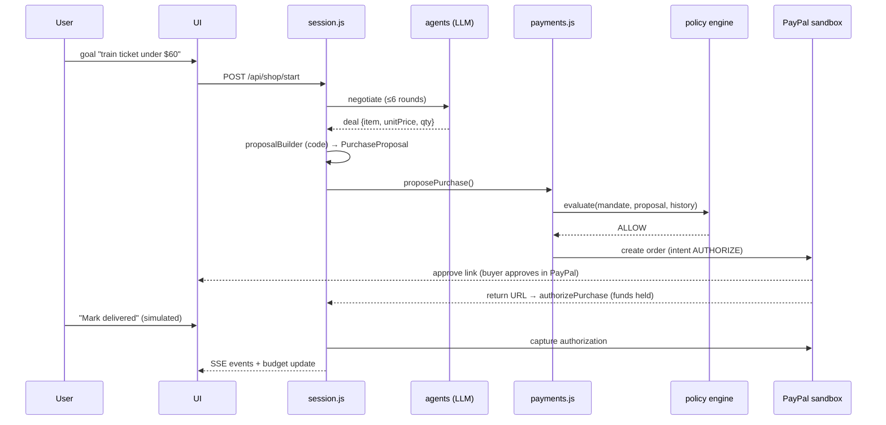
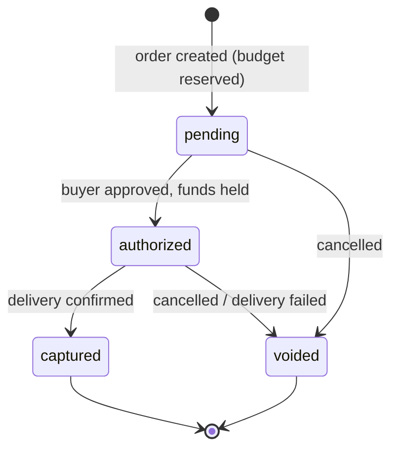

# ARCHITECTURE.md — Mandate

> **Core principle: the LLM proposes; deterministic code disposes.**

Legend: ✅ done and tested · ⚠️ written, untested · 🔲 to build · (opt) optional

---

## 1. System overview

```
                         ┌────────────────────────────────────────────┐
                         │ Browser — Next.js UI (app/, components/)   │
                         │ Mandate · Budget · Feed · Approval · Grid  │
                         └───────────────┬────────────────────────────┘
                                REST + SSE (EventSource)
                         ┌───────────────▼────────────────────────────┐
                         │ Next.js route handlers (app/api/**)        │
                         │ thin: Zod-validate → call core → emit event│
                         └───────────────┬────────────────────────────┘
                                         │
        ┌────────────────────────────────▼─────────────────────────────────┐
        │ src/server/   in-memory state · SSE event bus · session runner   │
        └───────┬───────────────────────────────┬──────────────────────────┘
                │ proposals (untrusted)         │ decisions + money
   ┌────────────▼─────────────┐     ┌───────────▼──────────────────────────┐
   │ src/agents/  (LLM)       │     │ src/payments.js ── src/policy/engine │
   │ parser · buyer · merchant│     │        │            (pure, no LLM)   │
   │ negotiation loop         │     │        ▼                             │
   │ NO PayPal, NO payments   │     │ src/paypal/ (mock | real) ─► PayPal  │
   └──────────────────────────┘     │ src/ledger.js (audit + purchases)    │
                                    └──────────────────────────────────────┘
```

**One-way rule:** agents produce *proposals*. Only `src/payments.js` can move money, and it always calls
`evaluate()` first. Agents cannot import `payments.js` or `paypal/` (enforced by a test, §9).

---

## 2. Complete file structure

```
mandate/
├── ARCHITECTURE.md                  ✅ this file
├── AGENTS.md                        ✅ rules for IDE agents (read first)
├── CLAUDE.md                        ✅ pointer → AGENTS.md
├── GEMINI.md                        ✅ pointer → AGENTS.md
├── README.md                        ✅ setup, demo link, what's mocked, third-party services
├── LICENSE                          ✅ MIT (must be visible at repo root)
├── package.json                     ✅ type: module; scripts: test, demo:core (+ dev, build, start 🔲)
├── package-lock.json                ✅
├── jsconfig.json                    🔲 alias  @/* → ./src/*
├── next.config.mjs                  🔲 minimal; no experimental flags
├── render.yaml                      🔲 Render service definition (build/start/health/env)
├── .env.example                     ✅ all env vars documented (see §8)
├── .gitignore                       ✅ node_modules, .env*, .next, dist
├── .github/
│   └── workflows/test.yml           🔲 (opt) CI: npm ci && npm test
│
├── docs/                            ✅ detailed specs for IDE agents
│   ├── 00-PROJECT_BRIEF.md
│   ├── 01-ARCHITECTURE.md           (superseded by this file; keep or delete)
│   ├── 02-DOMAIN_SPEC.md            schemas, policy rules, invariants
│   ├── 03-PAYPAL_INTEGRATION.md     lifecycle, sandbox setup, Path A/B, webhooks
│   ├── 04-AGENTS_SPEC.md            parser, negotiation, attack scenario
│   ├── 05-UI_SPEC.md                layout, components, states
│   ├── 06-API_SPEC.md               routes + SSE events
│   ├── 07-ROADMAP.md                day-by-day checklist
│   ├── 08-DEMO_AND_SUBMISSION.md    video script, Devpost checklist
│ 
│
├── src/                             ← framework-free core (no Next/React imports)
│   ├── money.js                     ✅ toCents / fromCents / fmt (integer-cent math)
│   ├── schemas.js                   ✅ MandateSchema, PurchaseSchema (Zod 4, strict)
│   ├── ledger.js                    ✅ audit log + purchase records (in-memory)
│   ├── payments.js                  ✅ proposePurchase → authorize → confirmDelivery / cancel
│   │
│   ├── policy/
│   │   └── engine.js                ✅ evaluate() → ALLOW | ASK_HUMAN | DENY (+ reasons)
│   │
│   ├── paypal/                      one interface, two backends
│   │   ├── index.js                 ✅ createPaypalClient(mode) — only mock/real switch
│   │   ├── mock.js                  ✅ in-memory fake (records calls for tests)
│   │   ├── real.js                  ⚠️ PayPal sandbox REST client (from docs, untested)
│   │   └── webhook.js               🔲 verify signature + normalize events (idempotent)
│   │
│   ├── agents/                      LLM layer — proposals only
│   │   ├── llm.js                   🔲 provider/model factory + injected-llm contract
│   │   ├── mandateParser.js         🔲 text → draft mandate {mandate, assumptions, unclear}
│   │   ├── buyerAgent.js            🔲 buyer turn → validated NegotiationMessage
│   │   ├── merchantAgent.js         🔲 merchant turn (honest + "shady" personas)
│   │   ├── negotiation.js           🔲 bounded loop (≤ 6 rounds) + code-enforced rules
│   │   ├── proposalBuilder.js       🔲 agreed deal + catalog → PurchaseSchema object (CODE only)
│   │   ├── messageSchema.js         🔲 NegotiationMessage Zod schema
│   │   ├── prompts/
│   │   │   ├── mandateParser.js     🔲 system prompt
│   │   │   ├── buyer.js             🔲 system prompt (no payment tools, distrust merchant text)
│   │   │   └── merchant.js          🔲 honest + attack personas
│   │   └── scripted/
│   │       ├── normalDeal.js        🔲 canned transcript (no API calls)
│   │       └── attackDeal.js        🔲 canned manipulation transcript
│   │
│   ├── data/
│   │   └── merchants.js             🔲 MOCK catalog: merchants, items, floorPrice, bulk tiers
│   │
│   └── server/                      app state shared by route handlers
│       ├── state.js                 🔲 singleton: mandate, ledger, paypal client, sessions
│       ├── events.js                🔲 tiny pub/sub → SSE
│       ├── session.js               🔲 runs negotiation, builds proposal, calls payments
│       └── guards.js                🔲 single-active-session + simple rate limiting
│
├── app/                             🔲 Next.js App Router (Node runtime)
│   ├── layout.js                    🔲 fonts, theme tokens, <html lang>
│   ├── page.js                      🔲 the single dashboard page
│   ├── globals.css                  🔲 CSS variables (light/dark), layout, chips
│   └── api/
│       ├── health/route.js          🔲 GET → {ok:true} (Render health check)
│       ├── mandate/
│       │   ├── route.js             🔲 GET active mandate+budget · POST confirm mandate
│       │   └── parse/route.js       🔲 POST text → draft mandate (not applied)
│       ├── shop/
│       │   ├── start/route.js       🔲 POST {goal, attack?} → {sessionId}
│       │   └── [id]/events/route.js 🔲 GET SSE stream for a session
│       ├── purchases/[id]/
│       │   ├── approve/route.js     🔲 POST  ([id] = proposalId) human approves ASK_HUMAN
│       │   ├── decline/route.js     🔲 POST  ([id] = proposalId)
│       │   ├── deliver/route.js     🔲 POST  ([id] = purchaseId) simulated delivery → capture
│       │   └── cancel/route.js      🔲 POST  ([id] = purchaseId) void / free budget
│       ├── paypal/
│       │   ├── return/route.js      🔲 GET buyer approved → authorizePurchase → redirect /
│       │   ├── cancel/route.js      🔲 GET buyer cancelled → cancelPurchase → redirect /
│       │   └── webhook/route.js     🔲 POST verified PayPal events
│       ├── ledger/route.js          🔲 GET {audit, purchases, budget}
│       └── demo/
│           ├── attack/route.js      🔲 POST "simulated compromised agent" → proposePurchase
│           └── reset/route.js       🔲 POST clear mandate, ledger, sessions
│
├── components/                      🔲 React UI
│   ├── Header.js                    logo · Sandbox badge · Reset demo
│   ├── MandateCard.js               textarea → parse → editable rules → confirm
│   ├── RuleEditor.js                editable chips/fields for each mandate rule
│   ├── BudgetMeter.js               captured / reserved / remaining
│   ├── GoalBar.js                   goal input + Start
│   ├── NegotiationFeed.js           buyer/merchant bubbles + decision chips
│   ├── DecisionChip.js              ✅ Allowed / ⚠️ Needs approval / ⛔ Blocked + reasons
│   ├── ApprovalCard.js              Approve / Decline for ASK_HUMAN
│   ├── PaymentStatus.js             stepper: order → approved → held → delivered → captured/voided
│   ├── AuditLedger.js               AG Grid Community table
│   ├── RedTeamButton.js             "Simulate compromised agent" (labelled simulated)
│   └── Toasts.js                    plain-language errors
│
├── lib/                             🔲 client-side helpers (browser only)
│   ├── api.js                       fetch wrappers for app/api/*
│   ├── useEventStream.js            EventSource hook + reconnect + resync from /api/ledger
│   └── format.js                    money/date formatting
│
├── public/                          🔲 favicon, logo, og-image
│
├── test/                            node:test  (npm test)
│   ├── policy.test.js               ✅ 19 tests: caps, thresholds, injection, cents, expiry…
│   ├── payments.test.js             ✅ 8 tests: lifecycle, reservation, DENY is final
│   ├── mandateParser.test.js        🔲 fake llm: missing caps → unclear; retry; errors
│   ├── negotiation.test.js          🔲 floor price, accept-only-offered, round limit
│   ├── proposalBuilder.test.js      🔲 fields come from catalog, never agent text
│   ├── webhook.test.js              🔲 signature rejects, idempotency
│   ├── state.test.js                🔲 reset, single-session guard
│   └── architecture.test.js         🔲 agents/ must not import payments.js or paypal/
│
└── scripts/
    ├── demo-core.js                 ✅ terminal walkthrough (mock or sandbox)
    ├── sandbox-smoke.js             🔲 create → approve link → authorize → capture → void
    └── print-tree.js                🔲 (opt) regenerate the tree for this file
```

---

## 3. Module responsibilities and dependency rules

| Module | Responsibility | May import | Must NOT import |
|---|---|---|---|
| `src/policy/engine.js` | Decide ALLOW / ASK_HUMAN / DENY. Pure. | `schemas`, `money` | anything with I/O, LLM, PayPal |
| `src/payments.js` | Only path to money. Evaluate → PayPal → ledger. | `policy`, `ledger`, a PayPal client (injected) | `agents/` |
| `src/ledger.js` | Audit log + purchase records | `node:crypto` | everything else |
| `src/paypal/*` | Talk to PayPal (or mock) | `node:*`, `fetch` | `agents/`, `policy/` |
| `src/agents/*` | Produce *proposals* and messages | `schemas`, `data/`, `messageSchema`, AI SDK | **`payments.js`, `paypal/`, `ledger.js`** |
| `src/server/session.js` | Orchestrates: negotiation → proposalBuilder → payments | everything in `src/` | React / Next |
| `app/api/**` | HTTP glue only | `src/server/*`, `src/schemas` | business logic |
| `components/`, `lib/` | Browser UI | React, AG Grid, `lib/*` | `src/` core (talk via `/api`) |

Why: invariant #2 — an LLM must never hold a handle that can spend. Keeping `agents/` unable to import
`payments`/`paypal` makes that structural, not just a convention.

---

## 4. Data models

**Mandate** (`schemas.js`, strict): `version, currency, monthlyCap, perPurchaseCap, approvalThreshold,
allowedCategories[], blockedCategories[], allowedMerchants[], blockedMerchants[], allowSubscriptions,
blockedKeywords[], expiresAt?`. Constraints: `perPurchaseCap ≤ monthlyCap`, `approvalThreshold ≤ perPurchaseCap`.

**PurchaseProposal** (strict): `merchantId, merchantName, category, amount, currency, description, isSubscription`.
Extra keys (e.g. `humanApproved`) are rejected.

**PolicyResult**: `{ decision, reasons: [{code, message}], purchase?, monthlyRemaining? }`

**Purchase record** (ledger): `{ id, orderId, authorizationId?, captureId?, amount, currency, merchantId, category, status, createdAt }`
`status ∈ pending | authorized | captured | voided`. Budget counts `pending + authorized + captured`.

**Audit entry**: `{ id, ts, type, ...data }` — types: `policy_decision, approval_requested, order_created,
funds_authorized, funds_captured, purchase_voided` (+ `negotiation_message, mandate_confirmed` as added.

**NegotiationMessage** 🔲: `{ from: 'buyer'|'merchant', action: 'offer'|'counter'|'accept'|'reject', unitPrice, quantity, text≤280 }`
— `text` is display-only and never parsed for instructions.

**CatalogItem** 🔲 (mock): `{ id, merchantId, name, category, listPrice, floorPrice, bulk[{minQty, discountPct}], isSubscription }`

---

## 5. Key flows

### 5.1 Happy path (in-mandate purchase)


### 5.2 Blocked path (attack)
`merchant text/inflated total → proposalBuilder → proposePurchase → evaluate → DENY (PER_PURCHASE_CAP, MONTHLY_CAP, KEYWORD_BLOCKED…) → no PayPal call → UI shows ⛔ with reasons → audit entry`.
The red-team button submits the manipulated proposal directly (clearly labelled *simulated compromised agent*).

### 5.3 Needs-approval path
`ASK_HUMAN → approval_required event → user Approve → proposePurchase(..., humanApproved:true)` (re-evaluated; DENY still wins) `→ order → …`.

### 5.4 Purchase state machine


---

## 6. Runtime and deployment

- **Runtime:** Node 22, Next.js App Router, route handlers pinned to the **Node runtime** (not Edge) — they use `node:crypto` and in-memory state.
- **State:** single in-memory singleton (mandate, ledger, sessions). Resets on restart; a **Reset demo** button resets on demand.
  Single instance only (do not scale horizontally); fine for a demo, stated in README.
- **Live updates:** Server-Sent Events with keep-alive every ~15 s; client reconnects and re-syncs from `GET /api/ledger` (ledger is the truth, events are a convenience).
- **Hosting:** Render web service (`render.yaml`): `npm ci && npm run build` → `npm start`, health check `/api/health`.
  Set PayPal return/cancel/webhook URLs to the public Render URL.
- **Fallbacks:** `NEGOTIATION_MODE=scripted` (no LLM calls) and `PAYPAL_MODE=mock` (no sandbox) keep the app demoable if an external service fails.

## 7. Tech stack

Node 22 · Next.js (App Router) · React · Zod 4 · Vercel AI SDK (`ai`) + a provider package (Claude via `@ai-sdk/anthropic`, or Gemini via `@ai-sdk/google`) ·
AG Grid Community (`ag-grid-react`) · plain CSS variables (Tailwind optional) · `node:test` · PayPal Orders v2 / Payments v2 (Sandbox) · Render.
Pin versions on install, then read **that version's** docs before coding against it.

## 8. Environment variables (`.env.example`)

| Variable | Purpose |
|---|---|
| `PAYPAL_MODE` | `mock` (default) or `sandbox` |
| `PAYPAL_CLIENT_ID`, `PAYPAL_CLIENT_SECRET` | Sandbox REST app credentials (never commit) |
| `PAYPAL_BASE_URL` | default `https://api-m.sandbox.paypal.com` |
| `PAYPAL_RETURN_URL`, `PAYPAL_CANCEL_URL` | e.g. `${APP_URL}/api/paypal/return` · `/cancel` |
| `PAYPAL_WEBHOOK_ID` | for webhook signature verification |
| `APP_URL` | public base URL of the app |
| `LLM_PROVIDER`, `LLM_MODEL` | `anthropic` or `google`, and model id |
| `ANTHROPIC_API_KEY` / `GOOGLE_GENERATIVE_AI_API_KEY` | provider key (check the provider package docs for the exact name) |
| `NEGOTIATION_MODE` | `live` or `scripted` |
| `MAX_ACTIVE_SESSIONS` | protect LLM credits on the public demo (default 1) |

## 9. Invariants enforced structurally

| # | Invariant | Where enforced |
|---|---|---|
| 1 | LLM never decides to spend | `policy/engine.js` is pure; `payments.js` always calls it first |
| 2 | Agents hold no payment capability | `architecture.test.js` fails if `src/agents/**` imports `payments.js`, `paypal/`, or `ledger.js` |
| 3 | DENY is final | `payments.js` branch order + test |
| 4 | Purchase fields come from code, not agent text | `proposalBuilder.js` + test |
| 5 | Money is integer cents | `money.js`; no float comparisons in engine |
| 6 | LLM output is validated | Zod on every agent output; reject, don't repair |
| 7 | Budget can't be overspent in parallel | `pending` orders count against budget immediately |
| 8 | No secrets in repo | `.gitignore`, `.env.example`, secrets never returned to client or logged |

## 10. Mocked vs real (disclose in README and video)

| Part | Status |
|---|---|
| PayPal payments | **Real sandbox** (Orders v2 authorize → capture/void) — no real money |
| Merchant catalog and pricing rules | **Mock** (`src/data/merchants.js`) |
| Delivery confirmation | **Simulated** ("Mark delivered" / merchant event) |
| Red-team "compromised agent" button | **Simulated**, labelled as such |
| Negotiation agents | Real LLM calls (`live`) or canned (`scripted`, fallback) |

## 11. Build order (maps to `docs/07-ROADMAP.md`)

1. PayPal sandbox smoke test (`scripts/sandbox-smoke.js`) → fix `real.js` → record Path A/B in `docs/03`.
2. `agents/llm.js`, `mandateParser.js` (+ tests with fake llm).
3. `data/merchants.js`, negotiation, `proposalBuilder.js` (+ tests, `architecture.test.js`).
4. `server/*` and `app/api/**`; verify end-to-end in mock mode.
5. UI components; AG Grid ledger.
6. Webhooks, polish, deploy to Render, README, video, submit (target evening of Nov 11).
